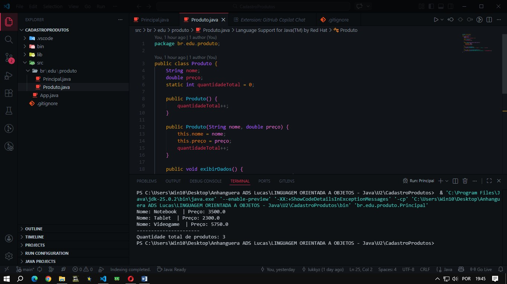

#  Sistema de Gestão de Inventário | Java POO

Uma aplicação de terminal desenvolvida em Java puro para simular o controlo de inventário e o registo de produtos. 

O projeto explora conceitos fundamentais de **Programação Orientada a Objetos (POO)**, focando na organização arquitetural do código, flexibilidade de instanciação e rastreamento de estado global da aplicação.

## 🎯 Objetivo do Projeto
Este sistema foi desenvolvido para modelar entidades de negócio reais (Produtos) e gerir o seu ciclo de vida em memória. O objetivo técnico principal é consolidar boas práticas de engenharia de software no ecossistema Java:
- Estruturação hierárquica e isolamento através de pacotes (`br.edu.produto`).
- Proteção de dados através de regras estritas de encapsulamento.
- Partilha de memória entre instâncias utilizando membros estáticos.

## 💻 Tecnologias e Arquitetura Aplicada
- **Java (Core):** Linguagem principal do desenvolvimento.
- **Sobrecarga de Construtores:** Implementação de múltiplos construtores na classe `Produto`, permitindo a inicialização flexível de objetos (com ou sem a injeção imediata de dependências/atributos).
- **Membros Estáticos (Static):** Utilização do modificador `static` no atributo `quantidadeTotal` para atuar como um contador global. Esta técnica garante que a contagem de inventário persista e seja partilhada de forma centralizada por todas as instâncias da classe.
- **Operadores de Incremento:** Automação da contagem de inventário diretamente na rotina de construção dos objetos.

## 🚀 Execução e Demonstração
O sistema instancia múltiplos produtos de forma independente, utilizando as diferentes assinaturas de construtores disponíveis. A cada novo registo, o contador global é atualizado automaticamente. 

Abaixo está a saída do terminal, exibindo a listagem individual dos produtos seguida pelo total consolidado no inventário:

> **Demonstração do Terminal:**
> 
> 
> 
> *(Nota: Sendo um ambiente de testes core, a formatação de moeda foi intencionalmente mantida em formato numérico primitivo).*

## 📂 Acesso ao Código Fonte
A arquitetura de pacotes, a modelagem da entidade e a rotina de execução podem ser analisadas nos ficheiros abaixo:
- [📄 Entidade Modelo (Produto.java)](https://github.com/lukkyzdev/CadastroProdutos/blob/main/CadastroProdutos/src/br/edu/produto/Produto.java)
- [📄 Rotina de Execução (Principal.java)](https://github.com/lukkyzdev/CadastroProdutos/blob/main/CadastroProdutos/src/br/edu/produto/Principal.java)

---
*Desenvolvido por Lucas Fontes com foco na aplicação de metodologias orientadas a objetos e boas práticas de arquitetura em Java.*
